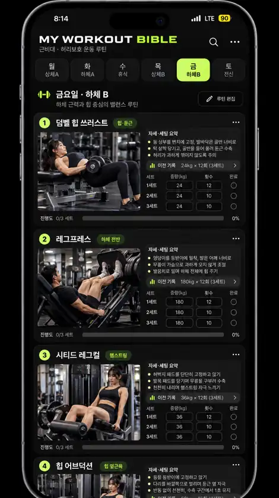

# MY WORKOUT BIBLE 💪

**운동 자세를 확인하면서 중량·반복횟수·세트 완료를 기록하는 개인용 운동 웹앱**

## 앱 접속
- [**MY WORKOUT BIBLE 실행하기**](https://92kwj1104.github.io/my-workout-bible/)
- [실사형 디자인 전체 시안](assets/workout_design_mockup.webp)

## 실사형 디자인 시안

## 최근 변경
- 검은색 + 네온 라임 포인트의 사진 중심 운동 카드 디자인
- 덤벨 힙 쓰러스트, 레그프레스, 시티드 레그컬의 **AI 생성 실사형 시안 이미지** 적용
- 요일별 7가지 근력운동, 앞부분을 우선 운동으로 표시하고 마지막 운동은 선택 보완
- 맨몸 글루트 브리지는 계획에서 제외하고 **덤벨 힙 쓰러스트**로 교체
- 기존 날짜별 중량·횟수·세트 완료·이전 기록 비교와 JSON 내보내기/복원 유지
- 아침 스트레칭·코어·실내자전거 루틴 유지

## 사진 및 운동 자세에 대한 주의
`assets/hip.webp`, `assets/legpress.webp`, `assets/legcurl.webp`, `assets/workout_design_mockup.webp`는 **AI로 생성한 디자인 시안 이미지**에서 제작되었습니다. 실제 트레이너가 시범을 보인 사진이 아니며, 사진만으로 자세의 정확성을 판단하면 안 됩니다.

나머지 일부 운동의 시작/끝 자세 일러스트는 [Workout Guide](https://bryllim.github.io/workout-guide/) (Bryl Lim / Everkinetic, CC BY-SA 4.0)와 [RepDB](https://repdb.co/) 운동 자료를 사용합니다. 두 자료의 각 라이선스 및 저작권 표시를 따릅니다.

## 운동 기록 보관
운동 기록은 **접속한 브라우저의 로컬 저장소**에 저장되며, 서버 계정이나 다른 기기로 자동 동기화되지 않습니다. 브라우저 저장 데이터를 지우기 전 **기록·비교 → JSON 백업** 기능을 사용하세요.
